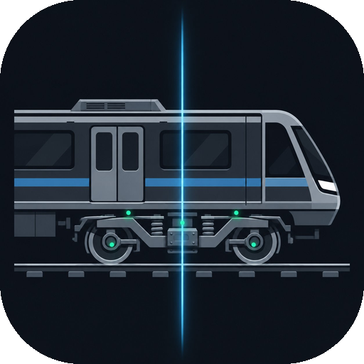
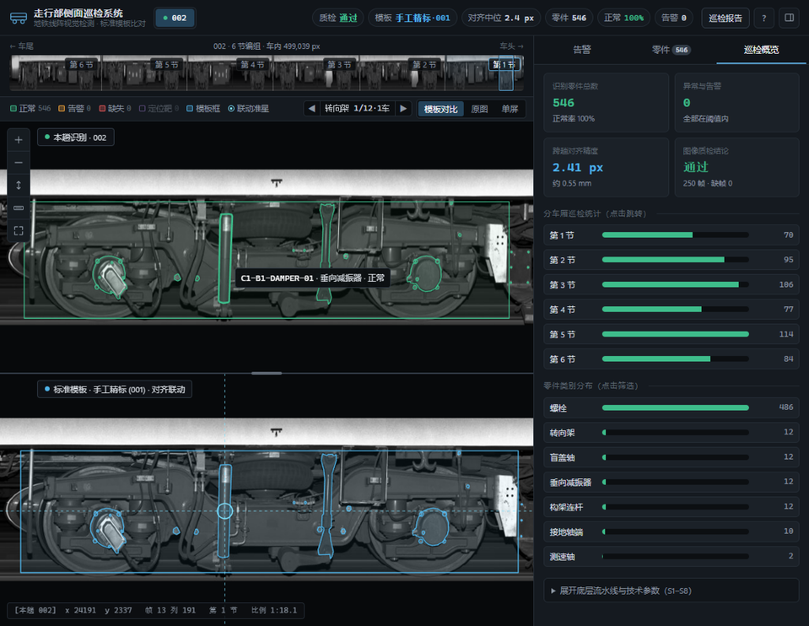
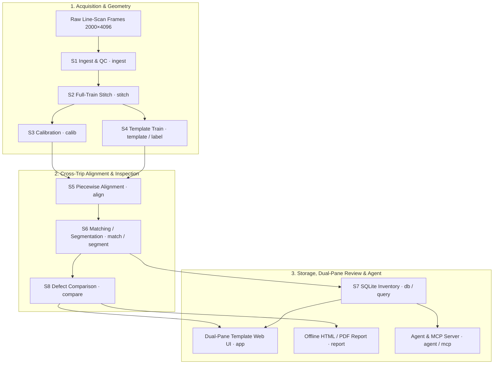
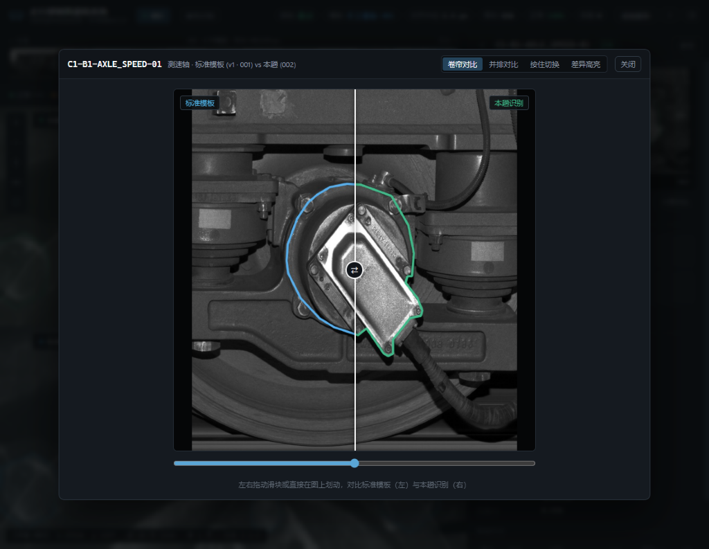
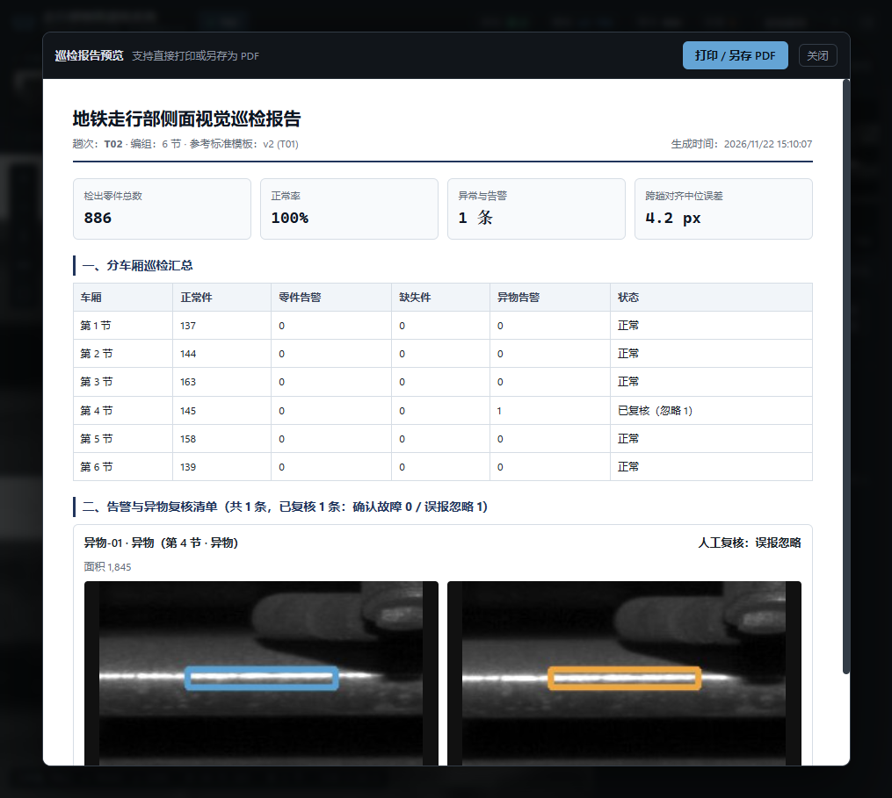
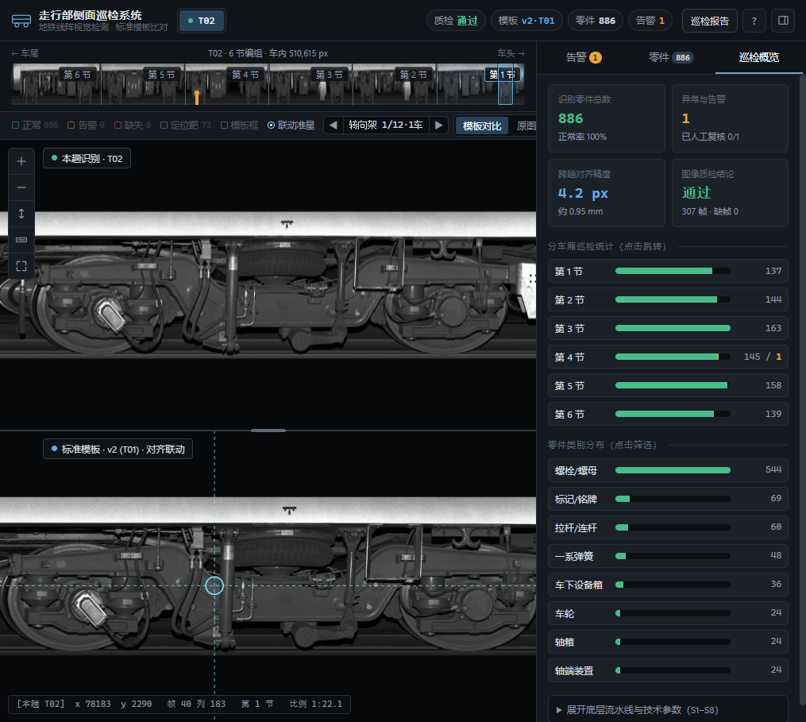

<div align="center">



# railside

**Side-View Line-Scan Visual Inspection System for Metro Trains**

*End-to-end engineering framework from raw line-scan camera frames to full-train stitching, piecewise template alignment, per-part defect detection, synchronized dual-pane web review, and MCP agent tooling.*

[简体中文](README.md) · [English](README.en.md) · [Changelog](CHANGELOG.md) · [Security & Compliance](SECURITY.md)

[](https://github.com/1Beyond1/railside/actions/workflows/ci.yml)
[](https://github.com/1Beyond1/railside/releases)
[](pyproject.toml)
[](LICENSE)
[](.github/workflows/ci.yml)

<br>



<sub>*Anonymized full 6-car real line-scan imagery (499,039 × 4,096 px, 1:1 native pyramid) rendered live in synchronized dual-pane template comparison mode: 546 hand-refined targets across 12 bogies and underframe boxes, 2.41 px ≈ 0.55 mm cross-trip alignment; zero operator, line, or vehicle identifiers.*</sub>

</div>

---

## Key Capabilities

- **One-Command Inspection Pipeline (`railside run`)**: Automates ingest quality control, full-train stitching, geometric `mm/px` calibration, multi-anchor piecewise alignment, hierarchical part matching, SQLite indexing, multi-criteria defect comparison, and HTML report generation.
- **Synchronized Dual-Pane Template Comparison (`railside app`)**: Pairs the inspected trip (top) with the standard reference template train (bottom) via `align.json` piecewise mapping to compensate for speed-induced horizontal stretch. Includes a **live synced crosshair**, **bogie-by-bogie stepper**, **toggleable template outlines**, and a **draggable split divider**.
- **Production Review & Reporting Workflow**: Interactive comparison modal (**Curtain Slider**, **Side-by-Side**, **Hold-to-Flip**, and **Pixel Difference Highlight**), full-part search & filtering, KPI overview dashboard, local manual review tracking, one-click **printable/PDF inspection reports**, and self-contained **read-only offline bundles** (`--export`).
- **30-Second Zero-Data Evaluation (`railside demo`)**: Programmatically synthesizes a privacy-free 3-car dataset (template `T01` + inspected trip `T02` with missing, rotated, displaced, and foreign-object alarms) so reviewers can verify the full pipeline and web UI out of the box.
- **Agent & MCP Integration (`railside agent` / `mcp`)**: Exposes database queries, alarm summaries, and pipeline execution over the Model Context Protocol (`stdio`).

---

## System Architecture



---

## Interface Showcase

<table>
  <tr>
    <td width="50%" valign="top">
      
      <p align="center"><b>Real Speed-Sensor Axle 1:1 Curtain Slider &amp; Pixel Diff</b><br><sub>Compare standard template (left cyan) vs. inspected trip (right green) via pixel-aligned curtain swipe, side-by-side, hold-to-flip, or live difference highlighting</sub></p>
    </td>
    <td width="50%" valign="top">
      
      <p align="center"><b>One-Click Printable / PDF Report</b><br><sub>Auto-generated 6-car maintenance report summarizing KPIs, per-car breakdown, side-by-side anomaly crops, and human review verdicts</sub></p>
    </td>
  </tr>
  <tr>
    <td colspan="2" valign="top">
      
      <p align="center"><b>1:1 Native-Resolution Deep Zoom &amp; Per-Part Quantitative Inspection</b><br><sub>Inspect individual hex bolts and cast-metal surface textures across synchronized panes backed by 0–19 native pyramids, paired with live NCC, millimeter shift, and angle metrics</sub></p>
    </td>
  </tr>
</table>

---

## 30-Second Quickstart (No Real Data Needed)

Requires Python 3.12+ and [uv](https://docs.astral.sh/uv/):

```bash
# 1. Install core dependencies (lightweight, without optional deep-learning group)
uv sync --no-group dl

# 2. Generate 100% synthetic demo dataset and run full pipeline (~15s)
uv run railside demo

# 3. Launch local dual-pane web viewer (default http://127.0.0.1:8765/)
uv run railside app
```

Run the automated test suite:

```bash
uv run pytest 源码/tests
```

> **Optional Deep-Learning Dependencies**: `pyproject.toml` includes a `dl` group (`ultralytics` for multi-scale YOLO-seg training/inference and SAM 2.1 pre-labeling; model weights are not distributed). Use `uv sync --no-group dl` for the core matching, web UI, and MCP workflow.

---

## Pipeline & CLI Reference

| Stage | Command | Description |
|---|---|---|
| **Ingest & QC** | `railside ingest` | Validates frame sequence, dropped frames, exposure, and blur while keeping raw frames read-only |
| **Stitch** | `railside stitch` | Stitches consecutive frames into per-car panels (`train_panels`), producing `manifest.json` and 1/8 previews |
| **Tiles** | `railside tiles` | Exports overlapping tiles in trip coordinates for labeling, training, and sliding-window inference |
| **Calibration** | `railside calib` | Computes local `mm/px` scale curves from known carbody reference geometry |
| **Template Train** | `railside template` / `label` | Builds frozen-code template trains with alignment anchors and part polygons |
| **Alignment** | `railside align` | Multi-anchor piecewise alignment compensating for speed stretch and vertical shift |
| **Segmentation** | `railside train` / `segment` | Optional multi-scale YOLO-seg dataset generation, training, and inference |
| **Part Matching** | `railside match` | Parent-guided localization, masked NCC matching, and topology fallback |
| **Database** | `railside db` / `query` | Writes normalized SQLite tables supporting per-car, per-bogie, and cross-trip history queries |
| **Comparison** | `railside compare` | Flags missing parts, millimeter displacement, angular rotation (`Δθ`), appearance drift, and foreign objects |
| **HTML Report** | `railside report` | Exports standalone per-trip HTML summary reports with part crops |
| **End-to-End** | `railside run <raw-dir> --trip <id>` | Runs the complete pipeline from raw frames to database and HTML report |
| **Web Viewer** | `railside app [--export <dir>]` | Launches the FastAPI + OpenSeadragon dual-pane viewer or exports a standalone offline bundle |
| **Synthetic Demo** | `railside demo [--out <dir>]` | Generates a 100% synthetic 3-car dataset and executes the entire pipeline end-to-end |
| **Agent / MCP** | `railside agent` / `mcp` | Natural-language CLI inspection agent and MCP `stdio` server (see [agent_mcp.md](源码/railside/agent_mcp.md)) |

---

## Engineering Quality & Layout

- **Automated Verification**: `167` unit, pipeline, evaluation, web-API, and end-to-end demo tests automatically verified on every push via [GitHub Actions CI](.github/workflows/ci.yml).
- **Privacy & Runtime Isolation**: All runtime datasets are strictly isolated under gitignored `数据/` (or `RAILSIDE_DATA`); see [SECURITY.md](SECURITY.md).

```text
railside/
├── .github/workflows/ci.yml   # GitHub Actions automated test workflow
├── 源码/
│   ├── railside/              # Core Python package & FastAPI web application
│   └── tests/                 # 167 automated synthetic tests (no real imagery required)
├── 主数据/                    # Master part-type taxonomy & comparison thresholds (零件类型.csv)
├── docs/assets/               # Anonymized real UI showcase screenshots (no raw datasets or operator info)
├── CHANGELOG.md               # Release history
├── SECURITY.md                # Security & data compliance policy
└── pyproject.toml             # Dependency & build configuration (uv)
```

---

## Data Notice & License

- **Data Ownership**: Real railway/metro imagery belongs exclusively to its respective operators/institutions and is **neither distributed in this repository nor covered by its license**.
- **Open-Source License**: Licensed under **GNU AGPL-3.0** — see [LICENSE](LICENSE). Derivatives, including network-service deployments, must disclose source code under AGPL-3.0.
- **Commercial Licensing**: For closed-source or commercial integration, please contact the author via GitHub.

Copyright © 2026 1Beyond1

<sub>Third-party notice: `源码/railside/app/static/vendor/openseadragon/` bundles OpenSeadragon 6.1.1 under BSD-3-Clause (see [LICENSE.txt](源码/railside/app/static/vendor/openseadragon/LICENSE.txt)).</sub>
