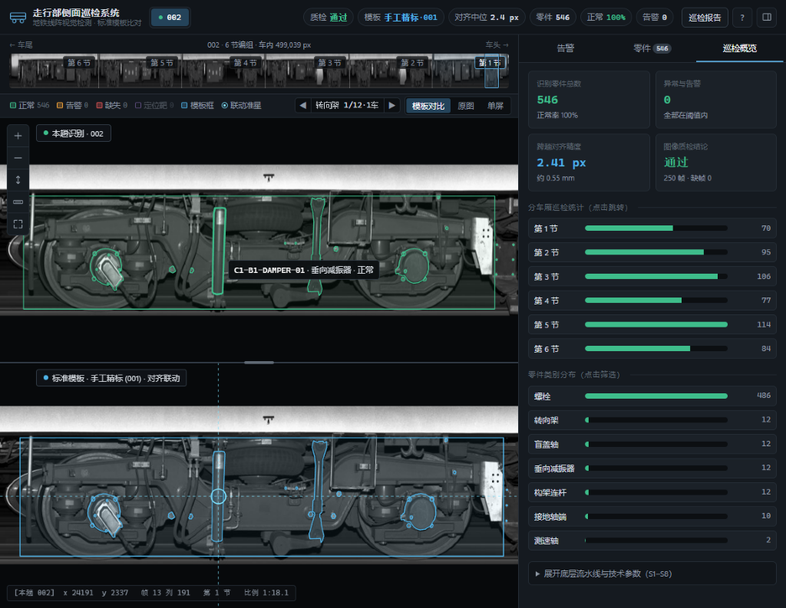
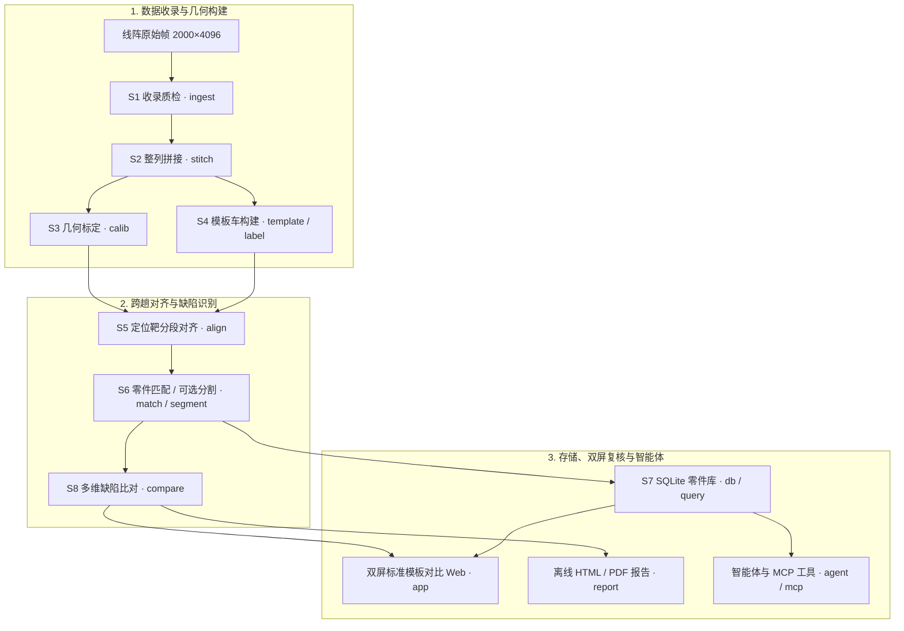
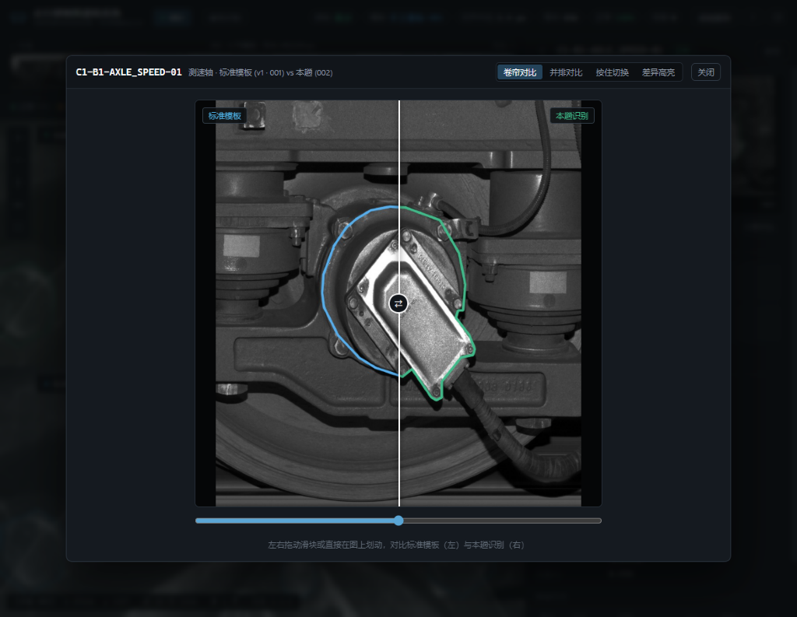
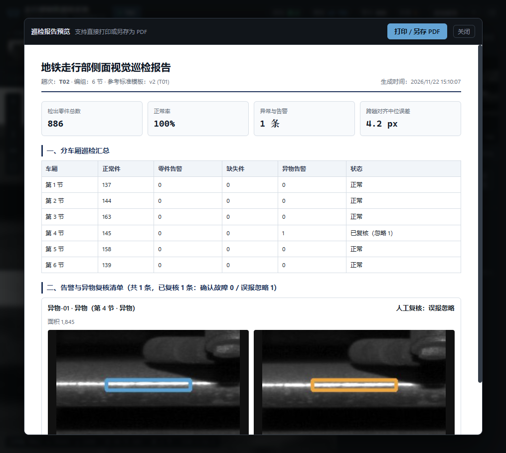
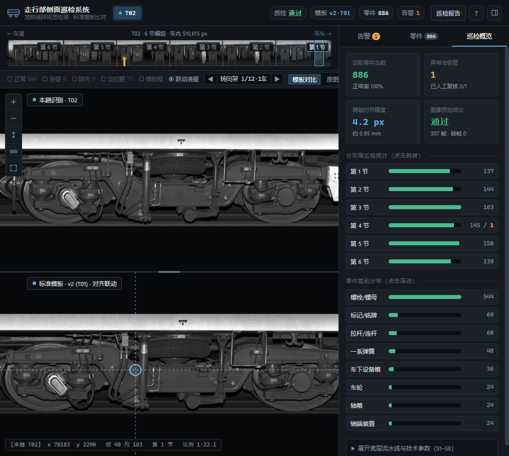

<div align="center">

# railside

**地铁列车侧面线阵视觉智能巡检系统**

*从原始线阵相机帧到整列长图拼接、分段对齐、零件识别比对、双屏标准模板联动浏览与智能体辅助诊断的一体化工程框架*

[简体中文](README.md) · [English](README.en.md) · [更新日志](CHANGELOG.md) · [数据安全与合规](SECURITY.md)

[](https://github.com/1Beyond1/railside/actions/workflows/ci.yml)
[](https://github.com/1Beyond1/railside/releases)
[](pyproject.toml)
[](LICENSE)
[](.github/workflows/ci.yml)

<br>



<sub>*以上界面为脱敏全列 6 节实拍线阵影像（车内 499,039 × 4,096 px，1:1 原图金字塔）的双屏标准模板比对实景：覆盖 12 台转向架与车下设备箱共 546 个手工精修目标，跨趟中位对齐误差 2.41 px ≈ 0.55 mm，不含任何线路、车号或运营单位信息。*</sub>

</div>

---

## 核心特性

- **全流程自动化流水线（`railside run`）**：一条命令打通收录质检、整列拼接、几何标定、定位靶分段对齐、多级零件匹配、SQLite 建库、多维缺陷比对与离线报告生成。
- **双屏「本趟识别 vs 标准模板」精准联动（`railside app`）**：基于 `align.json` 分段单调映射实现跨趟变速补偿，上下双屏 OpenSeadragon 深度缩放严丝合缝对齐；支持**实时联动十字准星**、**转向架逐台步进**、**模板标准轮廓叠加**与**自由拖动分屏**。
- **工业级复核与交付闭环**：提供**卷帘对比 / 并排对比 / 按住切换 / 差异高亮**四模式大图弹窗、全车零件检索筛选、巡检概览看板、告警人工复核记录，以及一键**可打印 / 另存 PDF 巡检报告**与免安装**离线浏览包导出**（`--export`）。
- **零数据 30 秒开箱验证（`railside demo`）**：内置 100% 程序合成脱敏数据生成器，无需外部影像即可在十余秒内生成 3 节编组双趟数据（含缺失、转角、位移、异物 4 类真实算法检出告警），立即验证全套算法与 Web 界面。
- **智能体与 MCP 工具接入（`railside agent` / `mcp`）**：将零件查库、告警汇总与流水线调度封装为标准 Model Context Protocol（stdio）工具，支持无缝对接外部 AI 客户端。

---

## 系统架构



---

## 界面实景展示

<table>
  <tr>
    <td width="50%" valign="top">
      
      <p align="center"><b>实拍测速轴端 1:1 大图卷帘 / 差异高亮对比</b><br><sub>支持标准模板（左蓝）与本趟识别（右绿）像素级卷帘划动、并排对照、按住闪烁切换与逐像素差值高亮，细微位移与转角一目了然</sub></p>
    </td>
    <td width="50%" valign="top">
      
      <p align="center"><b>一键可打印 / PDF 巡检报告</b><br><sub>基于 6 节编组整列巡检结果自动汇总 KPI、分车厢统计表、疑似异物前后对照裁切图与人工复核闭环结论，适配检修工区归档</sub></p>
    </td>
  </tr>
  <tr>
    <td colspan="2" valign="top">
      
      <p align="center"><b>1:1 原始清晰度深度缩放与逐件量化核查</b><br><sub>基于 0–19 层原图金字塔实现单颗紧固螺栓与铸件纹理级双屏联动放大，右侧同步呈现外观相似度（NCC）、毫米级偏移与转角量化指标</sub></p>
    </td>
  </tr>
</table>

---

## 30 秒快速体验（无需真实数据）

需要 Python 3.12+ 与 [uv](https://docs.astral.sh/uv/)：

```bash
# 1. 安装核心依赖（不含深度学习可选组，轻量秒装）
uv sync --no-group dl

# 2. 一键生成纯合成脱敏示例并跑通完整 9 步流水线（约 15 秒）
uv run railside demo

# 3. 启动本地 Web 双屏巡检界面（默认 http://127.0.0.1:8765/）
uv run railside app
```

如需运行全套自动化测试：

```bash
uv run pytest 源码/tests
```

> **关于深度学习可选依赖**：`pyproject.toml` 默认包含 `dl` 依赖组（`ultralytics`，用于多尺度 YOLO-seg 分割训练/推理与 SAM 2.1 框提示预标注；模型权重不随本仓库分发）。仅使用模板对齐匹配与 Web/MCP 服务时，推荐 `uv sync --no-group dl`。

---

## 流水线与子命令一览

| 阶段 | 命令 | 核心能力 |
|---|---|---|
| **收录质检** | `railside ingest` | 校验帧序完整性、缺帧、过暗/过曝与模糊帧，只读保护原始影像 |
| **整列拼接** | `railside stitch` | 按过车时序拼出整列车厢区间（`train_panels`），输出 `manifest.json` 与 1/8 缩略图 |
| **切片导出** | `railside tiles` | 按趟坐标切出重叠图块，用于人工标注、模型训练与滑窗推理 |
| **几何标定** | `railside calib` | 结合已知车体几何基准求解局部 `mm/px` 空间比例曲线 |
| **模板车** | `railside template` / `label` | 构建冻结编码的标准模板车：定位靶库、标准零件多边形与轮廓特征 |
| **分段对齐** | `railside align` | 多定位靶 + 加密块分段映射，补偿列车过车变速导致的横向拉伸与纵向抖动 |
| **可选分割** | `railside train` / `segment` | 基于模板趟标注构建多尺度 YOLO-seg 训练集、训练并在整趟滑窗推理 |
| **零件匹配** | `railside match` | 父件定位 + 掩膜内像素匹配 + 拓扑补漏，输出零件实例编码与匹配分 |
| **入库查询** | `railside db` / `query` | 写入规范化 SQLite 数据库，支持按趟次、车厢、转向架、类别与跨趟历史检索 |
| **缺陷比对** | `railside compare` | 检出缺失、毫米级位移、转角（Δθ）、外观差异与零件框外异物告警 |
| **离线报告** | `railside report` | 输出单趟独立静态 HTML 报告与局部对比图 |
| **一键流水线** | `railside run <原图目录> --trip <趟号>` | 从原始帧到入库与报告端到端执行 |
| **双屏应用** | `railside app [--export <目录>]` | 启动 FastAPI + OpenSeadragon 双屏对比界面，或导出零依赖只读离线浏览包 |
| **脱敏演示** | `railside demo [--out <目录>]` | 快速生成纯程序合成 3 节编组双趟示例数据并走通全流程 |
| **智能体接口** | `railside agent` / `mcp` | 命令行对话与标准 MCP（stdio）工具服务，详见 [agent_mcp.md](源码/railside/agent_mcp.md) |

---

## 工程质量与目录结构

- **自动化测试**：全套 `167` 项自动化测试覆盖拼接、标定、模板构建、分段对齐、匹配、入库查询、合成缺陷评测、Web 接口、离线包导出及 `railside demo` 端到端闭环，由 [GitHub Actions CI](.github/workflows/ci.yml) 在每次推送自动验证。
- **路径隔离与数据合规**：所有运行时数据均通过 `数据/`（或环境变量 `RAILSIDE_DATA`）隔离在 Git 之外，详见 [SECURITY.md](SECURITY.md)。

```text
railside/
├── .github/workflows/ci.yml   # GitHub Actions 自动化测试流水线
├── 源码/
│   ├── railside/              # 核心算法包与 FastAPI Web 应用（每步骤独立模块）
│   └── tests/                 # 自动化测试集（167 项，纯合成夹具，不依赖真实图像）
├── 主数据/                    # 零件类型定义与多维比对阈值表（零件类型.csv）
├── docs/assets/               # 脱敏实拍界面展示截图（不含任何原始数据集与运营信息）
├── CHANGELOG.md               # 版本变更记录
├── SECURITY.md                # 安全响应与数据合规声明
└── pyproject.toml             # 依赖与构建配置（uv 管理）
```

---

## 数据声明与许可协议

- **数据归属**：任何真实地铁线路列车影像数据均归所属运营/研究单位所有，**不在本仓库中分发，也不在开源许可范围内**。
- **开源许可**：本项目采用 **GNU AGPL-3.0** 协议开源，详见 [LICENSE](LICENSE)。自由使用、修改或以网络服务形式部署基于本项目的衍生软件时，须遵循 AGPL-3.0 公开对应源码。
- **商业授权**：如需在闭源产品、专有交付或企业级商业项目中使用，请通过 GitHub 联系作者获取商业授权。

Copyright © 2026 1Beyond1

<sub>第三方组件说明：`源码/railside/app/static/vendor/openseadragon/` 集成 OpenSeadragon 6.1.1（BSD-3-Clause，详见 [LICENSE.txt](源码/railside/app/static/vendor/openseadragon/LICENSE.txt)）。</sub>
